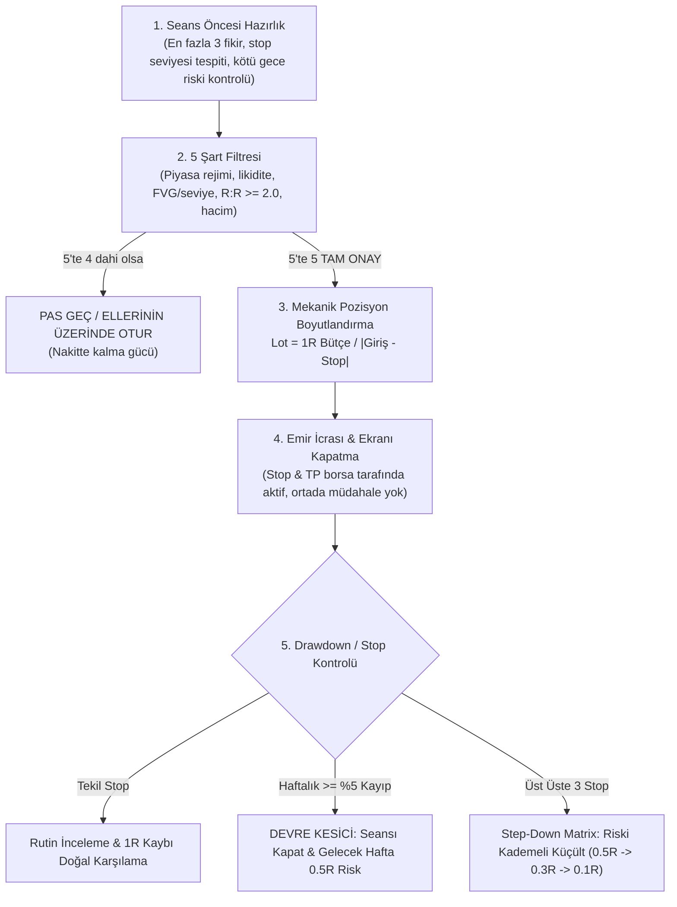

# Kurumsal Prop Desk Risk & İcraat El Kitabı (Master Playbook)

> **"Kasa tek bir oyunla ilgilenmez. Küçük ama sabit bir avantaj, çok sayıda tekrar ve sınırlı risk ile matematik her zaman galip gelir."**

---

## 1. Mimari Genel Bakış & Karar Akışı

---

## 2. Kasa Zihniyeti & Olasılık Matematiği

### Pozitif Matematiksel Beklenti ($E$)
Profesyonel trading bir kahinlik değil, pozitif beklenen değere ($\mathbb{E}$) sahip bir olasılık oyunudur.

$$\mathbb{E} = (P_w \times R_w) - (P_l \times R_l)$$

* **Örnek Kurumsal Dağılım:**
  * Kazanma Oranı ($P_w$): **%45**
  * Kaybetme Oranı ($P_l$): **%55**
  * Risk/Ödül Oranı ($R_w / R_l$): **2.0 R**
  $$\mathbb{E} = (0.45 \times 2.0) - (0.55 \times 1.0) = 0.90 - 0.55 = \mathbf{+0.35R}$$
* 100 işlem açıldığında 55 kez haksız çıkılmasına rağmen net kâr **$+35R$**'dır.

### Büyük Sayılar Kanunu & Varyans Toleransı
* 100 işlemlik bir periyotta üst üste **6 kayıp görme olasılığı %73**'tür.
* 5 kez ardışık stop olmak bir sistem arızası değil, istatistiksel bir kesinliktir.
* **Mark Douglas Kuralı:** Tek bir işlemin sonucu tamamen rastgele ve bağımsızdır. Ancak 100 işlemin sonucu kasanın kuralları gereği pozitiftir.

---

## 3. Sermaye Yönetimi & Pozisyon Boyutlandırma Formülü

### Dinamik Lot Hesaplama
Pozisyon büyüklüğü asla sabit bir kontrat adediyle açılmaz; stop mesafesine göre hesaplanır:

$$\text{Pozisyon Büyüklüğü (Lot)} = \frac{\text{Net Portföy Sermayesi} \times \text{Risk Yüzdesi (1R)}}{|\text{Giriş Fiyatı} - \text{Stop Loss Fiyatı}|}$$

* **Kural 1:** Tek bir işlemde risk asla hesap büyüklüğünün **%1.0'ını (maksimum %2.0)** geçemez.
* **Kural 2:** Stop mesafesi genişledikçe pozisyon boyutu küçülür; daraldıkça büyür. Stop vurulduğunda kaybedilen tutar her zaman sabit $1R$'dır.
* **Kural 3:** Dolar/TL yerine $R$ diliyle düşünülür. 1R kayıp, işletmenin hammadde maliyetidir.

---

## 4. Kriz Protokolü & Kanamayı Durdurma (De-Risking)

### Asimetrik Erime Gerçeği
Kasa kaybı logaritmiktir. Zarar büyüdükçe eski seviyeye dönmek için gereken kâr katlanarak artar:
* -%10 kayıp $\rightarrow$ +%11.1 kazanç gerekir.
* -%20 kayıp $\rightarrow$ +%25.0 kazanç gerekir.
* -%50 kayıp $\rightarrow$ +%100.0 kazanç gerekir (Hesabın ikiye katlanması imkansıza yakındır).

### Devre Kesici & Step-Down Protokolü

1. **Haftalık %5 Devre Kesici (Circuit Breaker):**
   * Haftalık gerçekleşen zarar portföyün **%5.0**'ına ulaştığı anda o haftanın tüm işlem yetkisi DERHAL dondurulur.
   * Ekran kapatılır, piyasadan uzaklaşılır.
2. **Yarı Risk Kuralı (Half-Risk Rule):**
   * Devre kesici sonrası yeni haftaya başlarken işlem başına risk tavanı **0.5R'a (%0.5)** indirilir.
   * Amaç hızlı para kazanmak değil; piyasayla ritmi yeniden yakalamak ve özgüveni mekanik olarak tazelemektir.
3. **Kademeli Pozisyon Küçültme (Step-Down Matrix):**
   * Üst üste 2 kayıp $\rightarrow$ Risk $0.5R$ seviyesine çekilir.
   * Üst üste 3 kayıp $\rightarrow$ Risk $0.3R$ seviyesine çekilir.
   * Üst üste 4 kayıp $\rightarrow$ Risk $0.1R$ seviyesine çekilir.
   * Form tutana ve ardışık kârlı işlemler gelene kadar vites büyütülmez.
4. **Maliyet Düşürme Yasağı (Anti-Averaging Down):**
   * Zararda olan bir pozisyona ilave alım yapmak kesinlikle yasaktır.
   * Stop seviyesi işleme girmeden önce belirlenir ve geriye çekilemez.

---

## 5. Günlük Prop Desk Rutini

### 1. Seans Öncesi (Pre-Market)
* **Biyolojik Kontrol:** Kötü uyunan veya yüksek stresli günlerde günlük risk tavanı %50 düşürülür.
* **Maksimum 3 Fikir:** Gün için yalnızca en yüksek olasılıklı 3 senaryo belirlenir. Bu 3 enstrüman haricinde gün içinde gelişen hiçbir harekete atlanmaz.
* **"Stopun Nerede?" Sorusu:** Stop seviyesi ve iptal şartı belirlenmemiş hiçbir fikir masaya getirilemez.

### 2. Seans İçi (Execution)
* **Ekran Kapalı Karar İlkesi:** Giriş, stop ve kâr al emirleri sisteme girildikten sonra ekrandan uzaklaşılır.
* **Nakitte Kalma Gücü:** Piyasa toksik veya yatay ise hiçbir şey yapmamak aktif bir pozisyondur.

### 3. Seans Sonrası (Post-Market & Journaling)
* **Günün Sorusu:** "Bugün planıma uydum mu?"
* **Arşivleme:** Günün en iyi grafiği kaydedilir, hatalar kategorize edilir.
* **Haftalık Tek Hedef:** Arka arkaya tekrarlanan bir hata tespit edilirse, gelecek haftanın tek hedefi o hatayı sıfırlamaktır.

---

## 6. Tetik Otonom Bot Entegrasyon Tablosu

| Prop Desk İlkesi | Tetik Dosyası / Modülü | Somut Parametre / Kural |
|:---|:---|:---|
| **Haftalık %5 Devre Kesici** | `config/risk_policy.seed.toml` | `max_weekly_drawdown_pct = 5.0`, `halt_duration = "end_of_calendar_week"` |
| **Step-Down Matrix** | `crates/agent/src/halt.rs` | 3 ardışık stopta `risk_multiplier = 0.5`; 5 stopta 48 saat dondurma |
| **Dinamik R-Multiple Sizing** | `crates/exec/src/orders.rs` | `qty = risk_budget_usd / abs(entry - stop_price)` |
| **Maliyet Düşürme Yasağı** | `crates/agent/src/run_loop.rs` | Mevcut pozisyon yönünde zarardayken yeni emir açılması engellenir |
| **Kaldıraç Tavanı** | `config/risk_policy.seed.toml` | `max_effective_leverage = 3.0` |
| **Mark Douglas 20 Sinyal Kapısı**| `config/setups.toml` | `min_shadow_trades = 20`, `require_lower_bound_above_zero = true` |
| **Kolektif Ajan Deski** | `prompts/analysts/`, `prompts/trader.md` | `Flow`, `Structure`, `Skeptic`, `Risk`, `Trader` konsensüsü |
