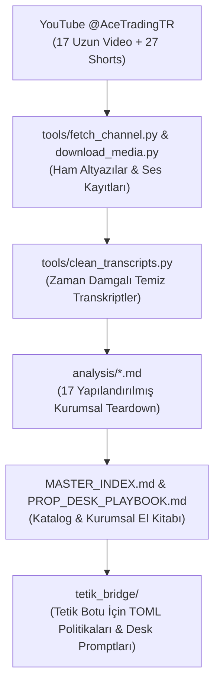

# Tradelib — Institutional Prop Trading Playbook & Research Library

Kurumsal tescilli işlem ofisi (**Proprietary Trading Firm**) metodolojisi, olasılık matematiği, sermaye koruma mimarisi ve sistematik icraat kütüphanesi.

Bu kütüphane, **Ace Trading TR** kurumsal eğitim arşivinin ve CEO Anton Panayatov'un hedge fund felsefesinin tam transkripsiyonu, derinlemesine analizi ve damıtılmasıyla oluşturulmuştur. Çıkarılan tüm kurallar, otonom trading botumuz [`tetik`](https://github.com/ddawnlll/tetik) ve kurumsal SMC/ICT playbook'umuz [`smc-ict-playbook`](https://github.com/ddawnlll/smc-ict-playbook) ile doğrudan entegre olacak şekilde tasarlanmıştır.

---

## Mimari & Veri Akışı

---

## Çekirdek Kurumsal İlkeler

### 1. Kasa Paradigması & Olasılık Matematiği
* **Kasa Olmak:** Trader'ın hedefi geleceği tahmin eden bir kâhin olmak değil; tıpkı bir kumarhanenin yeşil sıfırı gibi ufak bir avantaja (%2.7 edge), yüksek tekrara ve katı masa limitlerine sahip bir sistem işletmektir.
* **Pozitif Matematiksel Beklenti ($E$):** %45 kazanma oranı ve 1R Risk / 2R Kâr hedefiyle 100 işlemde **+35R net kâr** üretilir.
* **Varyans Gerçeği:** 100 işlem içinde üst üste **6 kez stop olma olasılığı %73**'tür. 5 ardışık stop matematiksel bir kesinliktir; kriz yönetimi 5. kaybın yaşandığı an başlar.

### 2. Kasanın Logaritmik Erime Matematiği & Devre Kesici
Kasa kaybı aritmetik değil, logaritmiktir:
* -%10 kayıp $\rightarrow$ +%11.1 kazanç gerekir.
* -%20 kayıp $\rightarrow$ +%25.0 kazanç gerekir.
* -%50 kayıp $\rightarrow$ +%100.0 kazanç gerekir.

> **Haftalık %5 Devre Kesici Kuralı:** Hesap haftalık bazda %5 eridiğinde o haftanın tüm işlemleri DERHAL durdurulur. Takip eden hafta risk %1'den %0.5'e indirilir.

### 3. Kanamayı Durdurma (Step-Down Matrix)
Kayıp serilerinde pozisyon asla ikiye katlanmaz (Martingale yasağı); aksine basamaklı olarak küçültülür:
$$\text{Normal (1.0R)} \longrightarrow \text{2. Stop (0.5R)} \longrightarrow \text{3. Stop (0.3R)} \longrightarrow \text{4. Stop (0.1R)} \longrightarrow \text{Zirve: 48 Saat Mola}$$

### 4. Dinamik R-Multiple Pozisyon Boyutlandırma
$$\text{İşlem Lot Büyüklüğü} = \frac{\text{Toplam Sermaye} \times \text{Risk Yüzdesi (1R)}}{|\text{Giriş Fiyatı} - \text{Stop Loss Fiyatı}|}$$
Risk sabit kalır ($1R$); stop mesafesi genişledikçe lot küçülür, stop daraldıkça lot büyür.

---

## Kütüphane İçeriği

* **[MASTER_INDEX.md](MASTER_INDEX.md):** 17 video ve konunun tam fihristi, etiketleri ve temel kuralları.
* **[PROP_DESK_PLAYBOOK.md](PROP_DESK_PLAYBOOK.md):** Kurumsal prop desk icraat, kriz, seans ve rutin el kitabı.
* **[analysis/](analysis/):** Her bir video ve konu için 5 bölümlük derin analiz teardown'ları:
  1. `01_Profesyonel_Trader_Olmak_Icin_Gercekte_Ne_Gerekir.md`
  2. `02_Kasa_Her_Zaman_Kazanir_Trader_Kasa_Olabilir_mi.md`
  3. `03_Yanlis_Mentorla_Yillari_Kaybetmek_5_Filtre.md`
  4. `04_Traderlarin_Cogu_Neden_Ilk_Yilda_Birakiyor.md`
  5. `05_Trader_Olmak_Ne_Kadar_Surer_Durust_Cevap.md`
  6. `06_Hala_Para_Kazanamamana_Sebep_Olan_5_Trading_Hatasi.md`
  7. `07_Evden_Trade_Neden_Pahaliya_Patlar_Ofisin_5_Avantaji.md`
  8. `08_Hangi_Trading_Stratejisi_Sana_Gore.md`
  9. `09_Profesyonel_Traderlar_Kanamayi_Bu_Sekilde_Durdurur.md`
  10. `10_Dogru_Trading_Mentoru_Nasil_Secilir.md`
  11. `11_Traderlarin_Yuzde_95i_Neden_Kaybeder_5_Kritik_Beceri.md`
  12. `12_Ust_Uste_Stop_Oldugunuzda_Ne_Yapmalisiniz_Kriz_Plani.md`
  13. `13_Islemlerin_Yarisinda_Yanilip_Yine_de_Para_Kazanmak.md`
  14. `14_Trading_Kariyerini_Yukseltecek_3_Efsanevi_Kitap.md`
  15. `15_Hesabinizi_Sifirlayan_5_Psikolojik_Tuzak.md`
  16. `16_Ace_Trading_CEO_Anton_Panayatov_Bloomberg_Teardown.md`
  17. `17_Mikro_Kurallar_ve_Shorts_Katalogu.md`
* **[tetik_bridge/](tetik_bridge/):**
  * `risk_rules.toml`: `tetik/config/risk_policy.seed.toml` için kurumsal parametreler.
  * `desk_prompts_patch.md`: Tetik analistleri ve icraat ajanı için kurumsal prompt yamaları.
* **[data/](data/):** Ham ve temizlenmiş transkriptler ile video metadataları.
* **[tools/](tools/):** YouTube indirme, temizleme, analiz derleme ve indeks oluşturma araçları.

---

## Lisans

MIT License.
