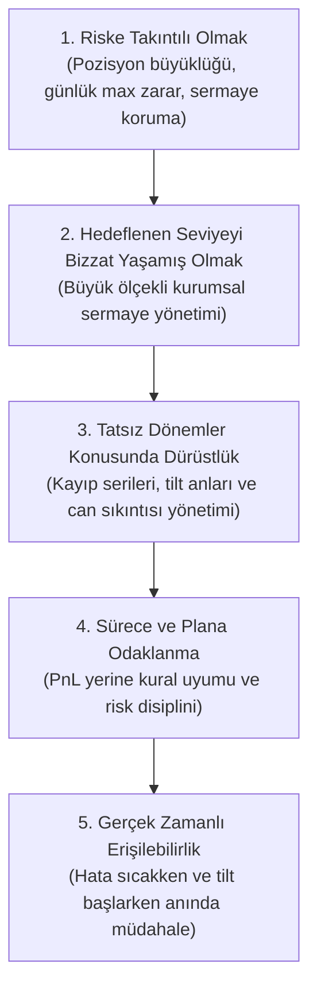

# 03 - Trader'ların Çoğu Yıllarını Yanlış Mentorla Kaybediyor (5 Filtre)

## 1. Yönetici Özeti
Finansal piyasalarda başarısız olan trader'ların en büyük ortak noktalarından biri, yıllarını yanlış insanlardan öğrenerek harcamalarıdır. İnternet pazarlama ustaları ve içerik üreticileriyle doludur; ancak bir başkasının tutarlı kâr etmesini sağlama yeteneğine sahip olanlar çok nadirdir.

---

## 2. Mentörlük İçin 5 Kurumsal Filtre

### Filtre 1: Riske Takıntılı Olmak
* Sahte mentör vaktinin %90'ını giriş noktaları, gizli indikatörler ve kusursuz kurulumlarla harcar.
* Gerçek mentör riske takıntılıdır: İşlem başına maksimum zarar, günlük limit, portföy ısısı ve oyun içinde kalma süresi üzerine odaklanır.

### Filtre 2: Ulaşmak İstediğiniz Yerde Olması
* Hedefiniz uzun vadeli tutarlılık ise, sadece şanslı bir ralli geçirmiş biri mentör olamaz.
* Hedefiniz kurumsal hacim yönetmek ise, 500$'lık hesapla ekran görüntüsü atan biri rehber olamaz.

### Filtre 3: Tatsız Dönemler Konusunda Şeffaflık
* Her ayının yeşil geçtiğini iddia eden biri yalan söylüyordur.
* Gerçek mentör; çekilme (drawdown) dönemlerinden, can sıkıntısından açılan gereksiz işlemlerden ve haftalarca hiçbir şey yapmadan oturmanın zorluğundan bahseder.

### Filtre 4: Sonuç Değil Süreç Odaklılık
* Zayıf rehber kârlı bir günün ardından coşar, zararlı bir günde hayal kırıklığına uğrar.
* Yetkin mentör trader'ın **nasıl** işlem yaptığına bakar: Plana uyuldu mu? Riske saygı gösterildi mi? Zorla işlem arandı mı?

### Filtre 5: Gerçek Zamanlı Hesap Verebilirlik
* Video kursları veya pasif Discord kanalları tilte giren trader'ı durduramaz.
* Gerçek prop desk ortamında yanınızda oturan kıdemli trader, yüz ifadenizden veya artan işlem sıklığınızdan tilte girdiğinizi fark edip masadan kaldırır.

---

## 3. Tetik Botu İçin Mimari Yansıma
Tetik sisteminde mentörlük rolü otonom ajan rollerine devredilmiştir:
* **`tetik/prompts/analysts/skeptic.md`:** Her trade tezini sorgulayan şüpheci kıdemli analist rolü.
* **`tetik/prompts/reviewer.md`:** Gün sonu seans planını ve gerçekleşen işlemleri denetleyen risk amiri rolü.
