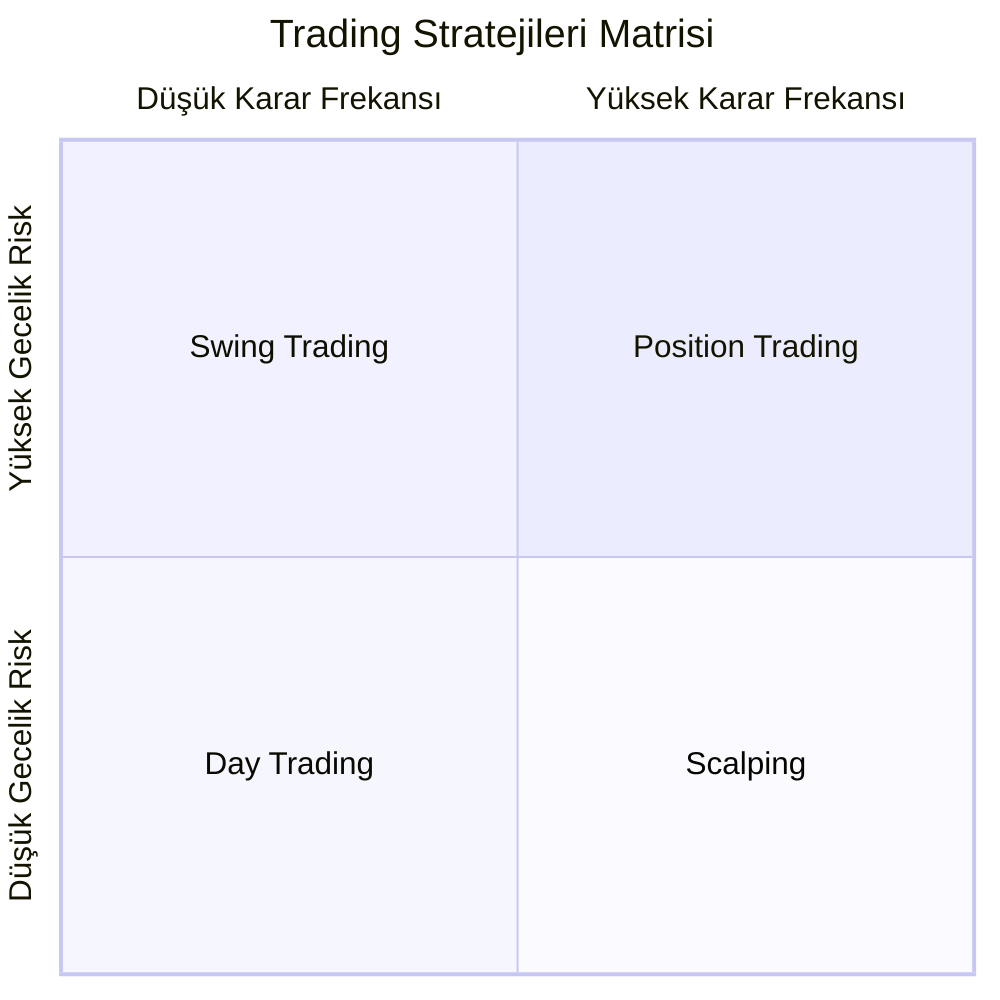

# 08 - Hangi Trading Stratejisi Sana Göre?

## 1. 4 Zaman Bazlı Stratejinin Karşılaştırması

| Strateji | Zaman Dilimi | Tutma Süresi | Gecelik Risk | Karar Frekansı | Uygun Profil |
|:---|:---|:---|:---|:---|:---|
| **Scalping** | 1m - 5m | Saniyeler - Dakikalar | **YOK** (Gün sonu flat) | Çok Yüksek | Yüksek refleks, tam gün ekran başında olanlar |
| **Day Trading** | 5m - 15m | Dakikalar - Saatler | **YOK** (Gün sonu flat) | Yüksek | Gün içi dalgaları kovalayan aktif trader'lar |
| **Swing Trading** | 1D - 1W (H4) | Günler - Haftalar | **VAR** (Gap riski) | Düşük | Çalışanlar, derin analiz yapıp alarm kuranlar |
| **Position Trading**| 1W - 1M | Haftalar - Aylar | **VAR** (Makro risk) | Çok Düşük | Trend takipçileri ("Cut losers, let winners run") |

---

## 2. Temel Prensip: "Zararları Kes, Kârları Büyüt"
Tüm stillerde geçerli evrensel Wall Street ilkesi:
$$	ext{Cut your losers short, and let your winners run.}$$

---

## 3. Tetik Entegrasyonu
Tetik BTCUSDT botumuz bir **Hibrit Day/Swing** modelidir:
* Bias & Rejim Analizi: 4H ve 1D (Swing temeli).
* Setup & Tetik Seviyesi: 15m ve 1h (Day trade icrası).
* Gece riski yönetimi: Stop emirleri Binance üzerinde borsa tarafında (exchange-native) donanımlı tutulur.
