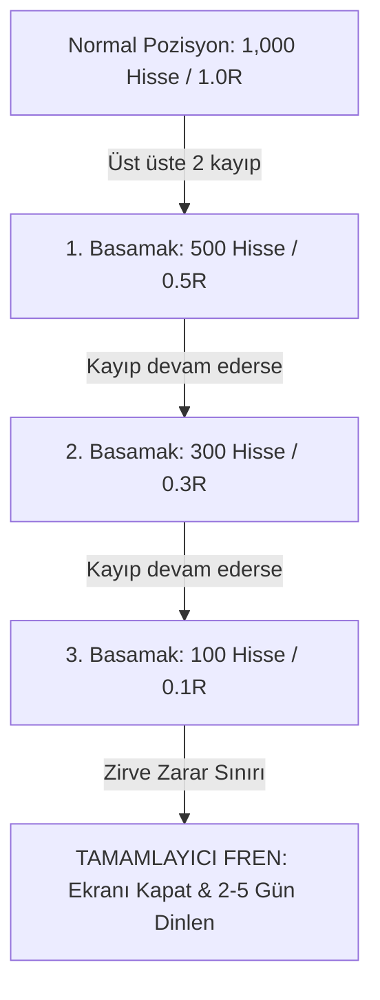

# 09 - Profesyonel Traderlar Kanamayı Bu Şekilde Durdurur

## 1. Çekirdek İlke: Kanamayı Durdurmak (De-risking Protocol)
Kayıp serileri her trader'ın başına gelir. İnternetteki stratejilerin %99'u işleme giriş üzerine odaklanırken, profesyonelleri hayatta tutan şey **zarar döneminde pozisyon boyutunu nasıl yönetecekleridir**.

> **"Çukura düştüğünüzde yapacağınız ilk şey, elinizdeki kazmayı bırakmaktır."**

---

## 2. Kademeli Pozisyon Küçültme Basamakları (Step-Down Matrix)

İşler kötü gittiğinde pozisyon büyüklüğü asla ikiye katlanmaz; aksine kademeli olarak küçültülür:

* Bu sayede trader en kötü formda olduğu dönemde piyasaya **en küçük riskle** maruz kalır.
* Sermaye tükenmezse oyun bitmez.

---

## 3. Nakitte Beklemenin Gücü (The Superpower of Doing Nothing)
* Emeklilik fonları ve kurumsal fonlar portföylerinin %90-%95'ini sürekli yatırımlı tutmak zorundadır.
* Bireysel ve bağımsız trader'ın en büyük lüksü **%100 nakitte bekleyebilme özgürlüğüdür**.
* Piyasa toksik veya volatil olduğunda hiçbir şey yapmamak aktif ve kazançlı bir pozisyondur.

---

## 4. Geri Dönüş Protokolü (Step-Up Protocol)
* Form tutana kadar risk artırılmaz.
* Arka arkaya pozitif ve kurallara uygun işlemler geldikçe pozisyon büyüklüğü kademeli olarak (100 -> 300 -> 500 -> 1000) eski haline getirilir.

---

## 5. Tetik Botu Mimari Kuralı
* **`tetik/crates/agent/src/halt.rs`:**
  * Üst üste 3 stop işleminden sonra: `risk_multiplier` otomatik olarak `0.5`'e çekilir.
  * Üst üste 5 stop işleminden sonra: Bot 48 saat boyunca kendini `HALT` durumuna alır (`cooldown_hours = 48`).
