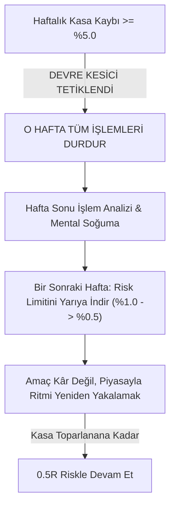

# 12 - Üst Üste Stop Olduğunuzda Ne Yapmalısınız? (Kriz Planı)

## 1. Varyans Gerçeği & Mike Tyson Kuralı
> *"Yüzüne sağlam bir yumruk yiyene kadar herkesin bir planı vardır." — Mike Tyson*

Yazı tura oyununda dağılım rastgeledir; bir yazı bir tura şeklinde gitmez. Büyük veri setlerinde ardışık kayıp serileri kaçınılmaz bir istatistiksel gerçektir.
Kusursuz bir sistemde bile **5 kez üst üste stop olmak kesin bir matematiksel olasılıktır**. Kriz yönetimi tam olarak 5. kaybın yaşandığı gün başlar.

---

## 2. Kasanın Logaritmik Erime Matematiği (Asymmetric Recovery)
Kasa erimesi aritmetik değil, **logaritmiktir**. Kayıp büyüdükçe eski seviyeye dönmek için gereken getiri eksponansiyel olarak artar:

$$	ext{Gereken Kâr \%} = \left(rac{1}{1 - 	ext{Kayıp Oranı}}
ight) - 1$$

| Kasa Kaybı | Başa Dönmek İçin Gereken Kâr | Yorum |
|:---|:---|:---|
| **-%5** | **+%5.26** | Tolere edilebilir, rutin dalgalanma |
| **-%10** | **+%11.1** | Rahat telafi edilir |
| **-%20** | **+%25.0** | Makas açılmaya başlar |
| **-%30** | **+%42.8** | Ciddi risk artışı gerektirir |
| **-%50** | **+%100.0** | Kalan tüm parayı 2'ye katlamak gerekir! |
| **-%75** | **+%300.0** | Pratik olarak hesap iflası |

---

## 3. Kurumsal Kriz Protokolü (Devre Kesiciler)



### Devre Kesici Kuralları:
1. **Haftalık %5 Kayıp Eşiği:** Hesap haftalık bazda %5 eridiğinde o haftanın tüm işlem yetkisi iptal edilir.
2. **Yarı Risk Kuralı:** Takip eden hafta risk tavanı %1'den **%0.5'e** çekilir.
3. **Zarar Eden Pozisyona Asla Ekleme Yapılmaz.**
4. **Stop Seviyesi Asla Geriye Kaydırılmaz.**

---

## 4. Tetik Botu Konfigürasyonu
* **`tetik/config/risk_policy.seed.toml`:**
```toml
[circuit_breaker]
max_daily_drawdown_pct = 2.0
max_weekly_drawdown_pct = 5.0
halt_on_weekly_breach = true
post_breach_risk_factor = 0.5
```
